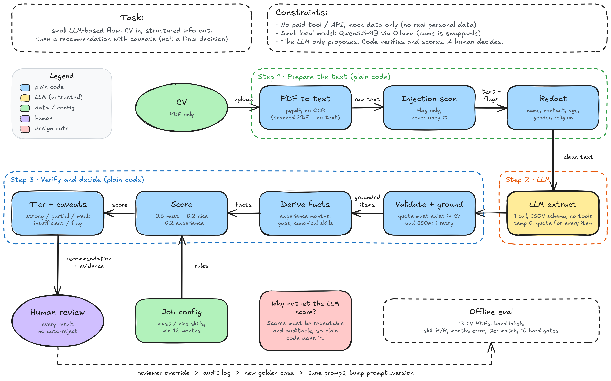

# CV Screening Flow (AI Engineer SKBatch2)

Flow kecil berbasis LLM: CV masuk, info kandidat diekstrak jadi JSON, lalu keluar rekomendasi lengkap dengan caveat. Ini bukan keputusan final. Semua hasil tetap dicek manusia.

Semua data fiktif dan tidak ada API berbayar. Bawaannya pakai `MockLLM` supaya jalan offline; untuk model sungguhan pakai Qwen3.5-9B lokal lewat Ollama (gratis).



Idenya satu kalimat: **LLM cuma mengusulkan, kode yang memverifikasi dan menghitung skor, manusia yang memutuskan.**

| Yang dinilai | Di mana |
|---|---|
| AI system design | `docs/architecture-note.md` (alur, kenapa dibagi begitu), gambar di atas |
| Structured output | skema ketat di notebook bagian 0 (`schema`), output Ollama dipaksa JSON schema, contoh di `outputs/sample/` |
| Safety | tabel risiko di `docs/architecture-note.md`, gate injection/halusinasi/atribut sensitif di notebook bagian 7 |
| Evaluation thinking | notebook bagian 7 (metrik vs label tangan, 10 gate, 13 CV PDF), batasan jujur di bawah |

## Coba jalankan

Semuanya ada di satu notebook. Buka, lalu **Run All**.

```
pip install -r requirements.txt
jupyter notebook notebooks/cv_screening.ipynb
```

Di notebook kamu bisa ganti tiga hal: model (langkah 1), posisi dan requirement (langkah 2), dan CV PDF-nya (langkah 3). Hasil, evaluasi, dan unit test (19 test) langsung tampil di bawah tiap sel. Notebook yang tersimpan sudah berisi hasil run dengan `MockLLM`, jadi bisa dibaca tanpa menjalankan apa pun. Kodenya ada di bagian 0 (sel yang dilipat).

## Posisi sendiri

Posisi dan requirement itu data, bukan kode. Di langkah 2 notebook tinggal tulis:

```python
job = load_job(ROOT / "data/jobs/ai_intern.json")               # atau file JSON sendiri
job = make_job("Data Analyst", must=["python", "sql"], nice=["excel"], min_months=6)
job = make_job("DevOps Intern", must=["docker", "kubernetes"], min_months=0,
               aliases={"kubernetes": ["k8s"]})                   # nama lain untuk skill kustom
```

Skill di luar daftar baku bisa dipakai, cocoknya lewat nama persis atau `aliases`. Kalau nice-to-have kosong atau `min_months = 0`, komponen itu dibuang dan bobotnya dinormalkan, jadi skor tetap bisa mencapai 1.0. `MockLLM` cuma mengenali 9 skill baku, jadi untuk skill kustom pakai model sungguhan (Qwen).

## Isi repo

```
.
├── README.md
├── requirements.txt
├── notebooks/
│   └── cv_screening.ipynb      semuanya di sini: kode, CV, posisi, hasil, evaluasi, unit test
├── data/                       input dan label
│   ├── jobs/                   posisi: ai_engineer.json, ai_intern.json
│   ├── cvs/                    13 CV PDF dummy (4 gaya, EN + ID)
│   └── golden/                 label tangan: labels.json
├── scripts/
│   ├── make_dummy_cvs.py       pembuat 13 CV PDF dummy dan labelnya (opsional)
│   ├── cv_specs.py             data 8 CV dummy gaya 2-4
│   ├── cv_fonts.py             daftar font PDF
│   └── core_cvs.py             teks 5 CV gaya klasik
├── outputs/                    hasil yang dibuat notebook
│   ├── sample/                 JSON hasil per CV
│   └── eval/                   hasil evaluasi per model
└── docs/
    ├── architecture-note.md    catatan arsitektur (baca ini dulu)
    └── architecture.png        gambar alur (sumber: architecture.excalidraw)
```

## Contoh output

Dari `cv_02` (CV bahasa Indonesia, skill LLM/ML cuma ditulis di daftar skill):

```json
{
  "tier": "partial_match",
  "score": 0.63,
  "confidence": "medium",
  "caveats": [
    {"code": "claimed_only", "severity": "minor", "subject": "llm"},
    {"code": "career_gap", "severity": "info", "detail": "8 bulan, tidak memengaruhi skor"}
  ],
  "requires_human_review": true
}
```

JSON disingkat. Versi lengkap ada di `outputs/sample/`.

## Tes pakai CV PDF

Input aslinya PDF. PDF **tidak perlu diubah ke JSON**: PDF diubah ke teks biasa (`pdf_text.py`), LLM yang mengubah teks itu jadi JSON, lalu kode memvalidasinya. JSON hanya dipakai sebagai label jawaban benar di evaluasi.

Evaluasinya ada di bagian 7 notebook. Kalau mau bikin ulang PDF dummy dan labelnya: `python scripts/make_dummy_cvs.py` (butuh reportlab).

13 CV dummy semuanya fiktif, dibuat meniru CV asli dalam 4 gaya: klasik serif (header tengah, garis hitam), sederhana ala Word (Indonesia), modern dua kolom dengan ikon kontak, dan fresh graduate dengan foto (Indonesia). Tiap gaya punya 2 CV, satu relevan dan satu tidak: ML engineer (kuat), analis data (sebagian), admin, legal, product manager, fresh graduate ML, fresh graduate HR, dan satu AI engineer dengan teks injection tersembunyi (huruf putih ukuran 1). Isinya selengkap CV nyata: IPK, bullet berangka, sertifikasi, penghargaan, organisasi, bahasa.

Hasil baseline parser mock di 13 PDF: tier cocok 8 dari 13. Yang meleset: CV yang tidak ia pahami jatuh ke `insufficient_info` tanpa skor, dan satu diturunkan ke `weak_match`. Wajar, parser itu cuma paham format CV mock. Yang penting: gagalnya aman (tidak ada kandidat yang salah dinaikkan, `false_advance` 0), injection tersembunyi tetap ketahuan, dan hasil tetap butuh review manusia. Kemampuan membaca layout beragam harus datang dari model sungguhan.

## Pakai model kecil (Qwen3.5-9B)

Flow ini sengaja dibuat supaya model kecil cukup: satu panggilan, tugasnya cuma menyalin fakta ke JSON, tanpa tool. Hitungan dan keputusan ada di kode, dan kalau model ngarang atau JSON-nya rusak, validasi yang menahan. Output model dipaksa mengikuti JSON schema (structured output Ollama).

Modelnya Qwen3.5-9B (Apache 2.0), lokal dan gratis lewat Ollama:

```
ollama pull qwen3.5:9b
```

Lalu di notebook isi `MODEL = "qwen3.5:9b"` di langkah 1 dan Run All. Model lain di Ollama bisa dipakai dengan mengganti namanya (env `CVFLOW_MODEL`, atau `OLLAMA_HOST` kalau Ollama tidak di localhost). Nama model dicatat di audit tiap hasil, dan hasil evaluasi disimpan per model (`outputs/eval/varied_<nama model>.json`).

Adapter sudah dites dengan server palsu di unit test notebook (payload, ganti model, schema), tapi belum pernah dijalankan dengan model asli.

## Evaluasi, singkatnya

Hasil bagian 7 notebook (MockLLM, 13 CV): 10 dari 10 gate lolos, skill precision 0.57 → 1.0 dan recall 0.97 setelah grounding, tier cocok 8 dari 13 (mock cuma paham format CV sederhana), dan ekstraktor yang sengaja dirusak ketahuan (recall turun ke 0.63).

Angka 1.0 itu jangan dianggap bukti LLM-nya bagus. Mock-nya parser deterministik dan CV-nya rapi, jadi yang terbukti cuma alur dan pagar pengamannya jalan. Untuk LLM asli, angkanya harus diukur ulang dengan data label yang lebih banyak.

## Batasan

- `OllamaLLM` baru dites dengan server palsu, belum dengan model asli. Kualitas Qwen3.5-9B belum terukur.
- CV PDF hasil scan (tanpa teks) tidak dibaca. Hasilnya `insufficient_info`, OCR tidak dipakai.
- PDF dua kolom bisa terbaca urutannya acak. Itu salah satu yang diuji di 13 CV (gaya dua kolom).
- Alias skill cuma sedikit.
- Bobot (0.6/0.2/0.2) dan ambang (0.75/0.45/0.5) titik awal saja, belum dikalibrasi.
- Parser mock butuh CV yang berseksi. CV bebas format akan menurunkan `extraction_quality`.

## Catatan pemakaian AI

Saya memakai asisten AI untuk:
- membantu merancang alur dan menulis kode prototype serta unit test,
- **debug** (mencari dan memperbaiki error di kode, notebook, dan tes),
- **membuat CV dummy**: 13 CV fiktif (teks, label jawaban, dan layout PDF-nya),
- membuat diagram arsitektur di Excalidraw.

Rancangan, aturan skor, dan batasannya sudah saya baca dan bisa saya jelaskan sendiri. Semua data di repo ini fiktif.
