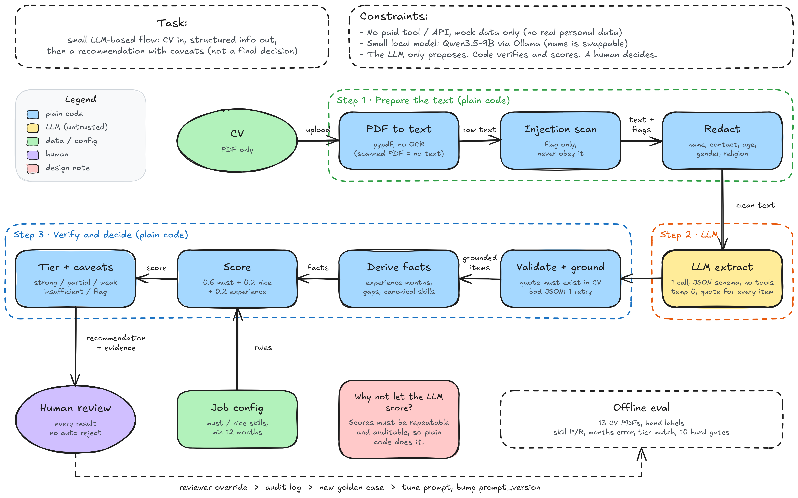

# Catatan arsitektur

## Masalahnya

Recruiter menerima banyak CV. Kita mau LLM membantu merangkum CV jadi data terstruktur dan memberi saran prioritas, tapi tanpa membiarkan LLM memutuskan nasib kandidat.

## Alurnya

0. **PDF jadi teks (kode).** CV PDF dibaca dengan pypdf jadi teks biasa. Bukan JSON; JSON dibuat LLM di langkah 2. PDF scan tanpa teks berakhir di `insufficient_info`.
1. **Scan + redact (kode).** Teks CV dicek untuk pola prompt injection (cuma di-flag), lalu nama, kontak, usia, gender, agama, status nikah, dan alamat dibuang. LLM tidak pernah melihatnya.
2. **LLM extract (1 panggilan, model kecil cukup).** LLM cuma menyalin fakta ke JSON sesuai schema, tiap item wajib bawa kutipan dari CV. Tidak ada tool, suhu 0.
3. **Validate + ground (kode).** Schema ketat (field asing ditolak). Item hanya lolos kalau kutipannya benar-benar ada di CV dan klaimnya ada di dalam kutipan. JSON rusak: retry sekali, lalu `insufficient_info`.
4. **Score + tier (kode).** Bulan pengalaman, gap karier, dan skor dihitung kode. Skor = 0.6 × must-have + 0.2 × nice-to-have + 0.2 × pengalaman. Skill yang terbukti di pengalaman dapat 1.0, yang cuma ditulis di daftar skill dapat 0.4.
5. **Recruiter memutuskan.** Setiap hasil `requires_human_review = true`. Tidak ada tier reject.

Kenapa pembagian ini: LLM tidak konsisten kalau disuruh menghitung dan menilai, jadi dua hal itu dipindah ke kode yang bisa dites. Output LLM dianggap input tidak tepercaya.

## Schema utama

- **Ekstraksi (dari LLM):** `education[]`, `experience[]`, `skills[]` (konteks: `demonstrated` atau `listed`). Tiap item punya `evidence` (kutipan) dan `confidence` 0..1.
- **Profil (kode):** ekstraksi yang lolos validasi, plus `extraction_quality`, `experience_months`, `skills_normalized`, `gaps`.
- **Rekomendasi:** `tier`, `score` (bisa `null`), `confidence`, `rationale[]`, `caveats[]`, `requires_human_review`.

## Aturan tier (cocok pertama menang)

1. Injection ditemukan → `flag_manual_review`
2. Kualitas ekstraksi < 0.5 → `insufficient_info` (skor `null`)
3. Skor ≥ 0.75 → `strong_match`
4. Skor ≥ 0.45 → `partial_match`
5. Selain itu → `weak_match`

## Safety

| Risiko | Penanganan |
|---|---|
| Prompt injection di CV | Di-flag, LLM tanpa tool, skor dari kode. Kalau LLM menurut, hasilnya dibuang dan di-retry |
| Bias dari atribut sensitif | Dibuang sebelum LLM, tidak masuk skor, dicek lewat gate invariansi |
| LLM ngarang | Item tanpa kutipan yang cocok dibuang, tidak mengubah tier |
| Output rusak | Retry sekali, kalau tetap rusak: `insufficient_info`, skor `null` |
| Terlalu percaya otomatis | Human review wajib, gap karier cuma info |

## Cara evaluasi

- **Kualitas:** bandingkan dengan label tangan (13 CV PDF): precision/recall skill, selisih bulan pengalaman, kecocokan tier, false advance, false flag.
- **10 gate keras** (semua harus lulus): bukti harus ada di CV, injection ketahuan dan skor tidak berubah, atribut sensitif tidak memengaruhi hasil, selalu review manusia, halusinasi tertahan, LLM yang nurut injection tertahan, LLM rusak tidak pernah dapat skor, eval bisa mendeteksi ekstraktor yang dirusak.
- **Data uji:** 13 CV PDF dummy (4 gaya layout, EN + ID), dijalankan di bagian 7 notebook dengan Qwen3.5-9B (atau mock sebagai baseline).
- **Di produksi:** override recruiter disimpan, lalu dijadikan kasus uji baru. Angka yang dipantau adalah tingkat ketidaksetujuan recruiter.

## Yang belum

LLM asli belum dites, label cuma 13 CV dan dibuat satu orang, bobot belum dikalibrasi. Detail ada di README.
